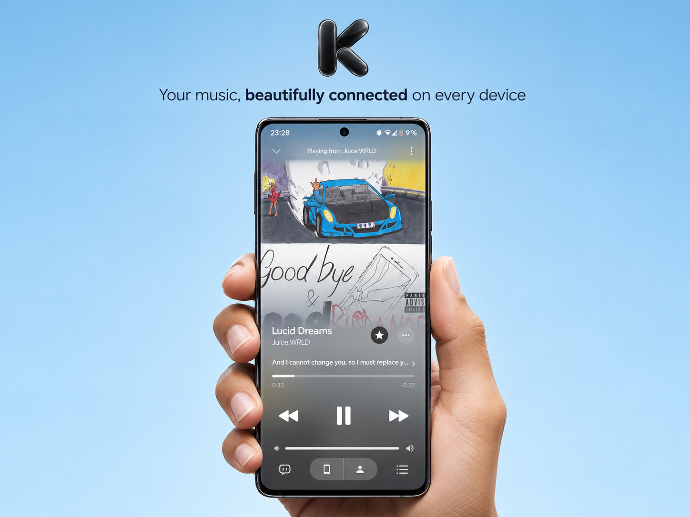

# Ketvoice 4.5.0

## Clean karaoke, without the doubled word effect

Sung words use exactly the same shaped glyph paths as the pending text. The
independently enlarged white word overlay and both diffused word copies are
removed, including their unused sustain/breathing machinery. The timing, foreign
script alignment, backing-vocal windows and white karaoke progression remain.
Held words do not acquire an offset, growing outline or delayed ghost after ending.

## One floating enclosure, not a pile of capsules

The mini-player, navigation and search now share a single optical enclosure. It
compacts into one row when the actual available width permits and expands without
replacing its transport component. Narrow windows retain the usable two-row form.
Only the moving navigation selection has its own inner lens; embedded controls
do not stack another complete glass surface on top of the enclosure.

## Glass that reacts without deforming its labels

The material adapts luminance in linear colour space, preserving backdrop colours
that already support readable content instead of applying a fixed grey veil.
Primary-label contrast is checked on bright, dark and coloured software fixtures.
The directional reflection follows the point of pressure and settles on release;
the surface compresses slightly while text, icons and hit targets remain stable.
Reduced motion removes this movement. Clear/Frosted/Opaque, matte content surfaces
and the safe unsupported-device/static fallbacks remain.

## A more coherent player and musical pages

- Pochette, Paroles and File d'attente have an explicit shared page selector.
  Phone identity and transport stay anchored across those views, and companion
  pages retain their saved list state. The cover view keeps immersive artwork.
- Tablet and Quest expose the same page choices without replacing the existing
  landscape 2D layout. Canvas focus, optional Stats info and the independent
  account/output/source actions remain.
- Album and artist pages expose compact playback/shuffle actions when the hero
  scrolls away. Both use the same large-font-safe action layout as the offline
  library. Album images remain full-bleed on phones.
- Artist identity is left-aligned below a shorter portrait. The broad whitening
  fade, duplicate blurred image pass and oversized fallback letter are removed.
  Available artist artwork and attribution remain, without invented sections.

## A library organised around your own music

- Search and views for Tout, Playlists, Albums, Titres and Artistes replace the
  repeated carousel dashboard. Favorites, Downloads, Local music and Replay stay
  directly accessible; playlist creation and Spotify/file imports are retained.
- Albums can be grouped from local metadata without a remote catalogue ID or an
  additional album request. Different artists' unnamed catalogue editions are
  kept separate; real compilation IDs keep their tracks together.
- Playlists can be pinned or unpinned. Pins are stored with the existing playlist
  JSON, remain backward-compatible with older files, and appear on Home as well
  as in the library. A failed persistent write is not announced as a saved change.
- Multiple selected songs can be played or added to the queue together. Catalogue
  media and server-side publication permissions are not changed by this feature.

## Offline management and a more personal Home

- Downloads add real state filters, local album grouping and multiple selection.
  Batch deletion shows the selected titles, count and size before confirmation;
  cancellation leaves every file intact. A failed file deletion keeps its metadata
  and remains an error instead of silently pretending success.
- Home leads with Resume listening when local listening state is available and
  shows pinned playlists. Its existing feed is de-duplicated into at most three
  recommendation shelves. This presentation makes no additional recommendation
  requests; the existing provider/cache behaviour is retained.

## Validation scope

JVM and native-software host checks cover unchanged lyric pixels after a held
word, primary-label shader contrast, stationary glyph bounds during pressure,
transport placement, local album grouping, filter separation, pin compatibility
and persistence, and cancellation/failure of destructive file operations.
The Windows host uses a same-directory atomic-move fixture for the AtomicFile
boundary; it is not proof of physical Android storage behaviour.

Software renders and mocked/host contracts are not physical phone or Quest
screenshots. Real GPU blur/refraction, install/launch, touch/controller feel,
measured FPS, live providers/downloads, DAC behaviour and owner-session Discord
consent/presence still require device validation. Instrumentation compilation is
not instrumentation execution.

French remains the default among eleven interface languages. Canvas and karaoke
are retained, group listening remains deferred, and verified-owner publishing
authorization remains server-enforced and unchanged.
