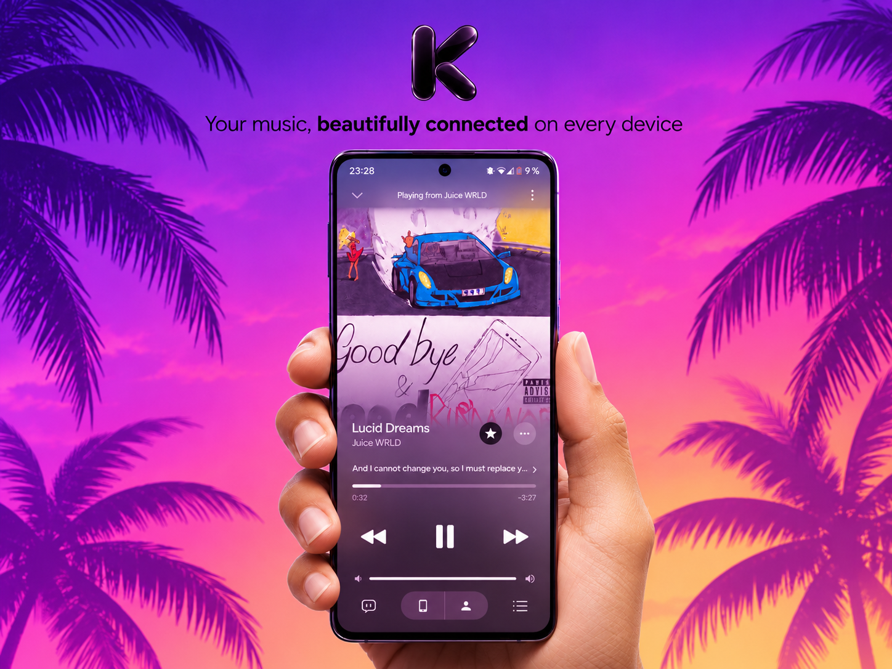

# Ketvoice 7.6.0

Canvas shown whole and kept for good, a much lighter app, voice level while streaming, volume points in your own mixes, new Ketmix transitions and a welcome step that sets everything up.

## Canvas

- **Shown whole**: a Canvas is no longer cropped. When its shape is close to the space it fills it; otherwise it is shown complete, as large as fits, with its own edge colours filling the rest, never a dark band. Your framing still comes first.
- **Kept for good**: every song's Canvas is now saved while you listen, even with the screen off on Wi-Fi, and the next two songs in your queue are fetched ahead. Playing an album again shows each Canvas at once.
- **The right Canvas on every song**: songs of the same album no longer all show the first song's Canvas.

## Faster

- The full player and the seek bar no longer redraw the whole screen many times a second while music plays, and the mini player and tab bar do far less work.
- While paused, the app wakes up a few times a minute instead of several times a second.
- The app starts lighter: translations load in the background and Downloads read less from storage.
- Cover colours are remembered when you scroll back.

## Voice and your own mixes

- **Voice level while streaming**: the voice slider now works on songs you stream. The part you are listening to is prepared first, and the slider works as soon as it is ready; the whole song is kept for next time.
- **Volume points in the mix editor**: tap the transition to place a point, then set Voice, Instruments and Music for the first song, and swipe to set them for the second. Points can be moved or removed and are drawn on each song's lane, so you can build a real mix of your own.

## Ketmix

- **Three new transitions**: “Cut” stops the outgoing song on the beat of a phrase, “On the drop” brings the next song in at its drop, and “Vocal handoff” lets one voice step back as the other starts.
- **Cleaner mixes**: filters fade in and out instead of switching, which removes clicks; songs meet with a smaller dip in level; and the two songs together never go past full scale.

## Welcome and icon

- **Improve your listening**: a new welcome step offers the voice separation models, the rhythm model where needed and a scan of the music on your phone, each with its size and live progress. It warns you if you continue without them, and it is also in Settings.
- The GTA VI event is over; its icon is now the default app icon. Other icons stay available in Settings. Ketvoice is not affiliated with Rockstar Games.

## Install

Download `Ketvoice-7.6.0.apk` (phone, Android 12 and up), `Ketvoice-7.6.0-Lite.apk` (lighter app, Android 11 and up) or `Ketvoice-7.6.0-Quest.apk` (Meta Quest) below and install it over your current version: your library, settings and downloads stay.
